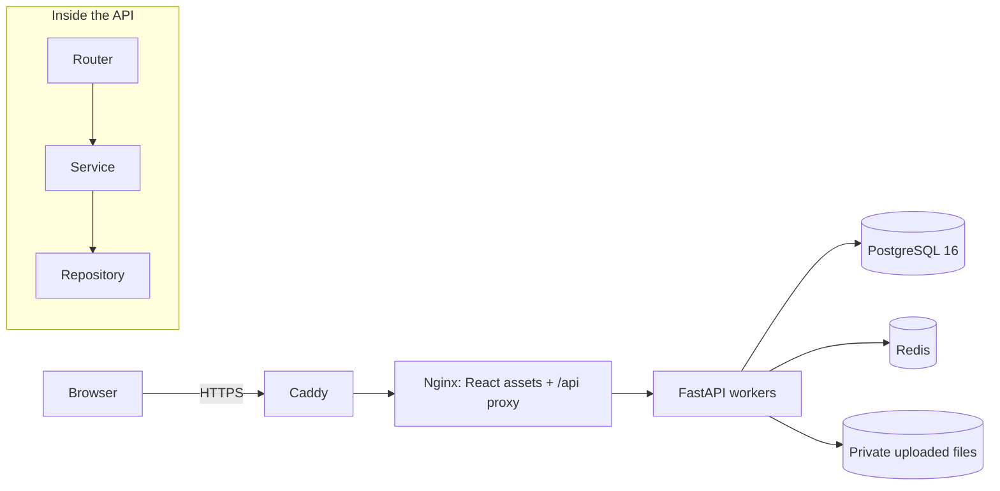
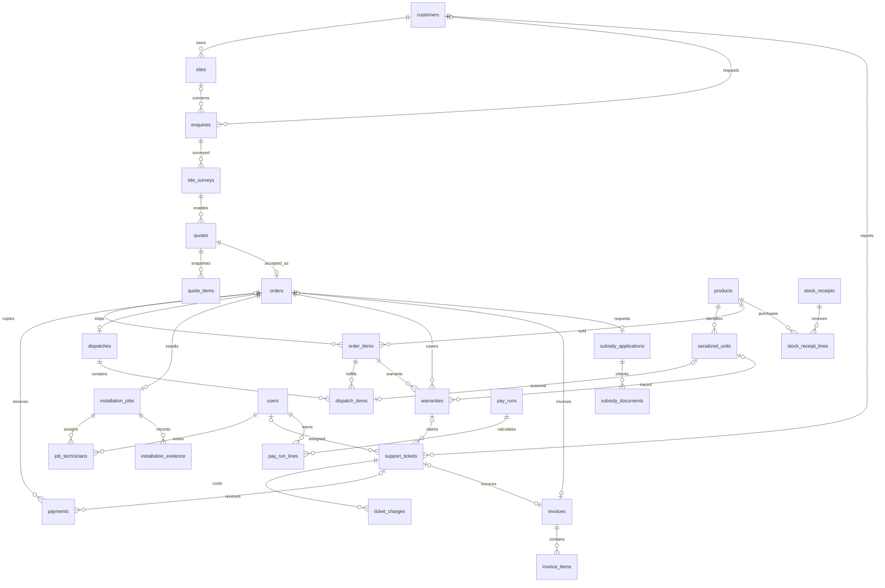

# SunPower Solutions

SunPower handles about 40 solar jobs a month with 15 technicians. Enquiries get lost between calls, WhatsApp and notebooks. Staff type quotes by hand and record equipment serials on paper. The director cannot see which installations made money or what warranty work cost.

## What is built

The backend implements these 13 workflows. The React role screens in this checkout are placeholders; use the API at `/api/docs` for the working demo. Browser role guards and completed workflow screens remain frontend work.

| Feature | Rule that makes it trustworthy |
| --- | --- |
| Enquiries and qualification | A qualified call must include roof area, monthly bill and grid suitability. |
| Site surveys | Quotes require an approved survey; a surveyor cannot approve their own work. |
| Package quotes | Component quantities expand from templates; prices, costs and GST are copied into line snapshots. |
| Orders and payments | The first payment atomically confirms the order and creates one pick list and one crew job; overpayment is blocked. |
| Stock receiving | Every serialized receipt has exactly one unique serial per unit; bulk receipts increase locked inventory balances. |
| Dispatch | Every required serial must be scanned and stock available before anything leaves the warehouse. |
| Crew installation | A technician cannot be booked twice on one date; completion needs photos, a passed power test and a signature. |
| Warranties | Delivery starts coverage on the IST delivery date, with one record per serialized unit or eligible bulk line. |
| Repairs and replacements | Coverage is frozen at ticket creation; covered work is free and closure requires a recorded customer confirmation. |
| GST invoices | Delivery and billable repair closure create immutable invoices with transactional financial-year sequences. |
| Subsidies | Applications advance one step at a time and require the appropriate document checklist. |
| Technician pay | Monthly drafts use completed installation hours and repair visits; paid runs cannot be recalculated. |
| Director dashboard | SQL aggregates include material, installation labour and warranty service cost; public shares expire and can be revoked. |

## Demo access

Live URL: **not configured in this repository**. After deployment use `https://<DOMAIN>` from your server `.env`; local web is [localhost](http://localhost), Swagger is [localhost/api/docs](http://localhost/api/docs). The direct development API uses [localhost:8000/api/docs](http://localhost:8000/api/docs).

Run both seeds below first. Password for every demo login: **see DEMO_PASSWORD**. The role table contains no credentials; email mappings are in `backend/scripts/seed_demo.py` and the [demo script](docs/demo-script.md).

| Role | Demo accounts |
| --- | --- |
| Director | 1 |
| Manager | 1 |
| Office | 1 |
| Warehouse | 1 |
| Technician | 3 |
| Support | 1 |

## Architecture

A modular monolith keeps the workflow in one deployment and lets payment, dispatch and warranty changes share a transaction. HTTP routers parse requests and enforce roles; services apply business rules; repositories perform database queries. Synchronous SQLAlchemy handlers run in FastAPI's worker thread pool.



Caddy is used only by the production Compose override. Local base Compose publishes Nginx on port 80; the development override adds the API on 8000 and Vite on 5173. The Nginx service is named `web` in Compose.

## Data model

Core relationships below come from the SQLAlchemy models' actual foreign keys and unique constraints. Audit, catalog component and auxiliary tables are omitted for space. `payments` and `invoices` each reference an order or a repair ticket, with a database check requiring exactly one parent.



## The automatic chain

Accepting a quote creates a pending-payment order. Its first payment creates the warehouse pick list and unscheduled installation job in the same transaction. Delivery starts warranties and issues the order invoice. Support finds the unit by serial, records coverage when opening a ticket and prices the repair accordingly; resolving work leaves it waiting for a staff-recorded customer confirmation, which closes it and issues a billable repair invoice when needed.

```mermaid
sequenceDiagram
    participant Office
    participant API
    participant DB as PostgreSQL
    participant Warehouse
    participant Support
    Office->>API: Record first payment
    API->>DB: One transaction: payment + confirmation + pick list + job + audit
    Warehouse->>API: Scan all serials, send, then deliver
    API->>DB: Delivery transaction: warranties + invoice sequence + invoice + audit
    Support->>API: Search serial and open repair ticket
    API->>DB: Freeze warranty coverage at opening
    Support->>API: Resolve work with parts and hours
    API->>DB: Save free or billed charges; status resolved
    Support->>API: Record customer confirmed=true
    API->>DB: Close ticket; invoice if billable and total greater than zero
```

## Stack

| Tool | Why |
| --- | --- |
| Python 3.12 / FastAPI | Typed HTTP contracts, validation and interactive API documentation. |
| SQLAlchemy 2 / psycopg | Explicit queries, Decimal values and row locks around workflows. |
| PostgreSQL 16 / Alembic | Relational constraints, transactional sequences and versioned migrations. |
| Redis | Running infrastructure dependency checked by readiness; request limits currently live in Nginx. |
| Pydantic 2 | Validates request bodies and defines response contracts. |
| React 19 / TypeScript / Vite | Existing frontend scaffold and reproducible static build. |
| Nginx / Caddy | Static serving, API proxy and limits, plus production TLS. |
| Docker Compose / GitHub Actions | Repeatable deployment and backend/frontend/config checks. |
| pytest / Ruff / k6 | Workflow regression tests, lint and measured concurrent read traffic. |

## Run locally

Use Docker Desktop or Docker Engine with Compose 2.24.4 or newer. From the repository root:

```sh
cp .env.example .env
docker compose up -d --build --wait
docker compose exec api alembic upgrade head
docker compose exec api python -m scripts.seed
docker compose exec api python -m scripts.seed_demo
```

PowerShell equivalent for copying the environment: `Copy-Item .env.example .env`. The entrypoint already migrates before the API starts; the explicit migration command is safe to repeat. Set a private `DEMO_PASSWORD` before sharing an environment; production seeding also requires `SEED_PASSWORD`. Keep passwords out of source control. API docs are at `/api/docs`, not `/docs`; `/api/health/ready` is the readiness URL through Nginx.

For live reload use `docker compose -f docker-compose.yml -f docker-compose.dev.yml up -d --build --wait`. This also publishes PostgreSQL on localhost:5432; if another project occupies that port, stop that project's database or use the base stack. Do not run two SunPower stacks on the same public ports.

## Tests and demo reset

```sh
docker compose exec api ruff check app tests
docker compose exec api python -m pytest -q
docker compose exec api python -m pytest --cov=app/services --cov-report=term-missing -q
```

Tests create/migrate/reset `<database>_test` on the same Postgres server; a URL already ending in `_test` is used directly. They do not truncate the development database. The database user needs permission to create the test database. For disposable environments only, reset all demo data with `make demo-reset`, or in PowerShell `./scripts/demo_reset.ps1`; this deletes that Compose project's database volumes. Server form: `make demo-reset COMPOSE="docker compose -f docker-compose.yml -f docker-compose.prod.yml"`, or `./scripts/demo_reset.ps1 -Prod` on a PowerShell host.

The demo seed skips when Ravi Kumar (demo) already exists; rerunning it will not recreate a half-reset demo. A full reset gives the same customers at each workflow stage. The [five-minute script](docs/demo-script.md) names them and explains the Swagger fallback.

## Security and deployment

P3-2 added private-route authentication tests; HttpOnly, SameSite=Lax, Path=/ cookies with Secure in production; same-origin production CORS; safe unexpected-error responses with request IDs; Nginx security headers, a 6 MB body cap and login/general API rate limits; DB/Redis readiness checks; production volumes and HTTPS; and CI. Secrets remain in untracked `.env` files. Read [deployment instructions](deploy/DEPLOY.md) and the [dependency audit](docs/security-audit.md), which records three remaining medium/low findings from that audit. Public dashboard links are bearer capabilities: anyone holding a valid link can read the summary until it expires or is revoked.

Customer confirmation is recorded by authorized staff; it is not an independently authenticated customer signature on a repair closure. Photo/signature validation checks file size and magic bytes, not the contents of a decoded image. These are the implemented boundaries, not claims of a full security audit.

## Verification and load

Workflow tests cover survey approval gates, component expansion, exact money, payment idempotency, stock shortages, wrong and duplicate serials, delivery warranties/invoices, installation crew ownership and double booking, evidence limits, warranty repairs/replacements, customer confirmation, subsidy steps, pay periods, dashboard IST boundaries and private route protection. The fresh-clone run passed **230 tests**, with **90% statement coverage of app/services** (1,823 statements, 188 missed; no minimum enforced). [Fresh-clone verification](docs/fresh-clone-check.md) records the build, migrations, seeds, end-to-end test and results for this task.

The recorded [k6 run](docs/loadtest.md) ramped to 50 virtual users and sustained them for 60 seconds: about 119.5 requests/second overall with 0% errors. Endpoint p95s were 554 ms for enquiries, 625 ms for serial search and 658 ms for the dashboard. This was a local laptop/dev-stack read workload, not evidence for 10,000 simultaneous users or write-heavy production traffic.

## Scaling

The API keeps authentication state in signed cookies; uploaded evidence must remain on shared storage. On the base/production stack, `docker compose up -d --scale api=3` can add API replicas behind Nginx (use the same production `-f` files on a server); the dev override's fixed port 8000 prevents that command from scaling unchanged. Increase workers within the VM's CPU/memory budget, check that Nginx resolves the replicas, and review per-worker connection pools before increasing replica count. Boot-time migrations should become a separate release step when coordinating multiple replicas.

Phone/serial indexes make exact lookup efficient. PostgreSQL is the likely next bottleneck: measure query plans and pool pressure, add PgBouncer, then consider a read replica or short-lived cache for dashboard aggregates. A queue can send SMS/WhatsApp later. Kubernetes is unnecessary until operational needs justify it; the load run does not establish linear scaling.

## Roadmap

Instant estimate; QR complaint stickers; customer tracking links; an AI call sheet; WhatsApp Business API; SMS (requires DLT registration); credit notes; HSN codes on invoices; completed frontend workflows. Serialized warranty replacement is already implemented, not a roadmap item.

## Eight key decisions

Full context is in [docs/decisions.md](docs/decisions.md).

1. One transaction contains each workflow action and its audit entries.
2. Row locks serialize competing changes; technician locks prevent concurrent bookings across jobs.
3. Database enums/status names are preserved and mapped by meaning.
4. Quotes and order lines snapshot prices, costs and tax; Decimal calculations round half-up.
5. UTC timestamps are converted to Asia/Kolkata for business dates and reporting periods.
6. Invoice numbers use a locked financial-year sequence in the invoice's transaction.
7. Warranty coverage is frozen when the repair opens; replacement inherits remaining coverage.
8. Tests use an isolated database, and demo records go through the real services.
